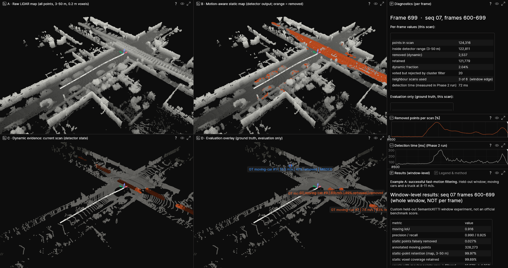
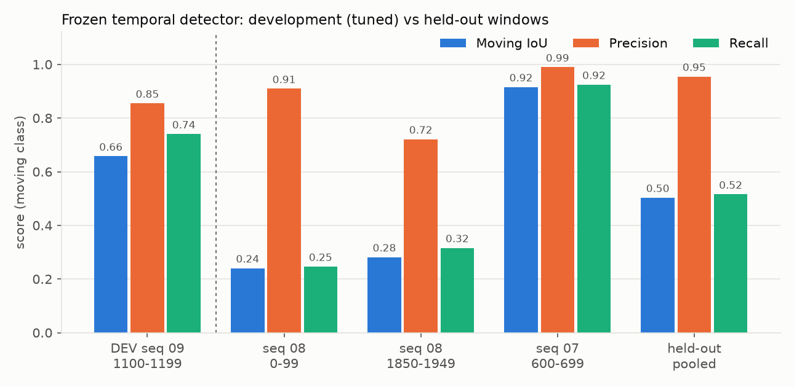
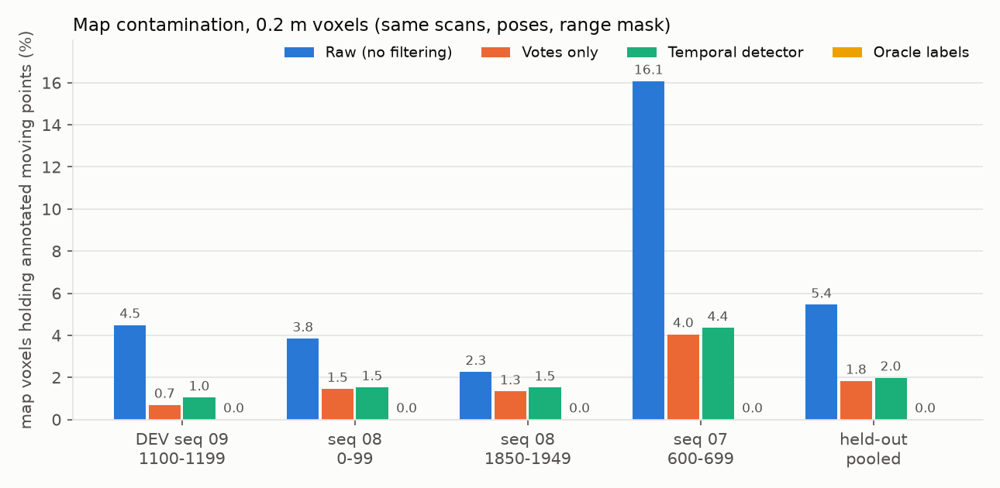
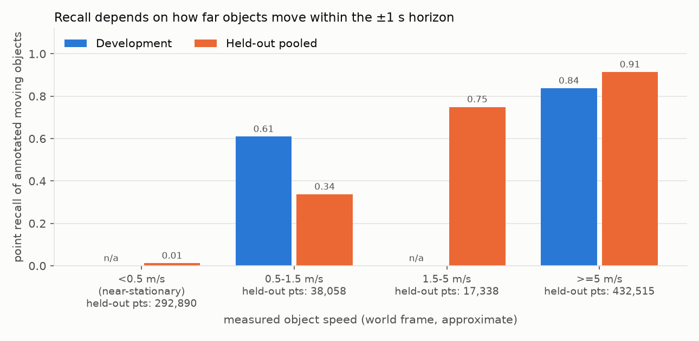

# DynamicMap3D

DynamicMap3D builds static maps from aligned KITTI Odometry scans. It tests whether a
point occupies space that nearby scans observed as free, then filters points with repeated
evidence of motion. The detector uses supplied poses and up to one second of future scans.

[](https://youtu.be/esyoNU5KZYc)

*Screenshot of the interactive Rerun viewer (not a rendering), held-out SemanticKITTI seq 07, frames 600–699, after
the last frame. **A** raw LiDAR map · **B** motion-aware static map, orange = points removed by the detector ·
**C** current scan coloured by detector state · **D** ground-truth comparison (evaluation only, never used by the
detector). Window moving IoU 0.916; held-out pooled moving IoU 0.503 (see below).*

The detector was frozen before evaluation on three held-out SemanticKITTI windows.
Sequence 09, frames 1100–1199, was used for development. The held-out results below
measure how well the same configuration transfers across motion regimes.
[Dataset provenance and calibration checks](DATASET_REPORT.md).

## Visual demonstration

[Watch the DynamicMap3D demonstration on YouTube](https://youtu.be/esyoNU5KZYc). Click the viewer screenshot above to open the video.

The demonstration compares raw and filtered maps, shows static-geometry preservation,
and examines missed slow-moving objects in the held-out windows.

Every 3D frame in the video is a window capture of the real Rerun viewer replaying saved detector outputs
(`results/phase3/predictions/`); the detector is not rerun and nothing is rendered by another tool. Scenes:

| # | Content | Window | Moving IoU |
|---|---|---|---|
| intro | Title over the completed viewer | seq 07, 600–699 | |
| 1 | Moving-object removal, maps accumulating during replay | seq 07, 600–699 (held-out) | 0.916 |
| 2 | Completed raw map vs motion-filtered static map | seq 07, 600–699 | |
| 3 | Static preservation: parked vehicles kept (evaluation layers) | seq 07, 600–699 | |
| 4 | Failure: near-stationary cars not detected (detector vs ground truth) | seq 08, 0–99 (held-out) | 0.241 |
| 5 | Missed moving geometry left in the filtered map | seq 08, 0–99 | |
| 6 | Failure: slow pedestrians and cyclists | seq 08, 1850–1949 (held-out) | 0.282 |
| summary | Pooled held-out metrics, method and limits | 3 held-out windows | 0.503 |

Notes: the replay runs at about 0.6× real time (100 scans in about 17 s; the viewer is rendering-bound while it
is captured), and the captions say so. Cuts between windows are labelled. Ground-truth layers are shown only in
views marked *evaluation only*. Captions take every number from `results/phase2/`. To regenerate the media (Windows,
needs a 1920×1080 display): `python scripts/capture_demo.py build|screenshot|video|verify`.

### Evaluation figures (held-out windows, frozen detector)

| | |
|---|---|
|  |  |
| Moving-class IoU, precision and recall per window. Development window (tuned) left of the dashed line. | Map voxels holding annotated moving points: raw map vs filtered maps. |



*Recall depends on how far an object moves within the ±1 s horizon: near-stationary objects (< 0.5 m/s) are almost
never detected.*

**Held-out results** (pooled over 3 custom SemanticKITTI windows, summed confusion counts; not an official
benchmark score): moving IoU **0.503**, precision **95.5%**, recall **51.6%**, static-point retention in the map
(3–50 m) **99.94%**. Per window: seq 07 600–699 **0.916**, seq 08 0–99 **0.241**, seq 08 1850–1949 **0.282**.
The tuned development window scored 0.658 moving IoU. In the held-out maps, static voxel
coverage was 99.83% and the fraction of voxels containing moving points fell from 5.45%
to 1.98%. [Saved evaluation summary](results/phase2/summary.json).

### Limitations

* **Offline and non-causal.** Each scan is tested against scans up to 1.0 s in the past *and future*, with the
  supplied KITTI poses. It is not an online or real-time detector, and not SLAM (poses are given, not estimated).
* **Slow motion is hard to observe.** A slow vehicle may move too little within the ±1 s
  window for a neighbouring scan to see through its previous position and cast a free-space
  vote. Near-stationary cars often remain in the map (seq 08, 0–99). The detector also misses
  many slow pedestrians and cyclists (seq 08, 1850–1949).
* **Static preservation is high but not perfect.** Some static points (for example poles and traffic signs) are
  removed; see the per-window `class_false_removal` values in `results/phase2/windows/*/metrics.json`.
* Three held-out windows of 100 scans each are a small sample.

## Temporal free-space test

For each target scan *t* and neighbouring scans *j* = *t* ± {3, 6, 10}, registered with known poses:

1. Project the points of *t* into the range image of *j*.
2. If *j* measured a return **beyond** the point along the same ray (tolerance 0.5 m + 2 % of
   range, minimum over a 3×5 pixel neighbourhood), the space was empty at time *j*: a free-space
   violation vote. A similar range is static evidence, and a closer range (occlusion) carries no information.
3. Points with ≥ 2 violations that are the majority of informative observations become
   candidates (non-ground, 3–50 m).
4. Candidate clusters (0.5 m linkage) with < 10 points are removed. Region growing is implemented
   but disabled: on the development window it added ~7× more false than true positives.

Code: `src/dynamicmap3d/motion/` · parameters: `configs/phase1.yaml`.

## Replay a saved window in Rerun 0.41

```bash
python scripts/view.py --seq 07 --frames 600:700       # A: fast-motion filtering (held-out, IoU 0.916)
python scripts/view.py --seq 08 --frames 0:100         # B: near-stationary objects missed (held-out, IoU 0.241)
python scripts/view.py --seq 08 --frames 1850:1950     # C: slow pedestrians/cyclists (held-out, IoU 0.282)
python scripts/view.py --seq 09 --frames 1100:1200     # development window (tuned)
```

* `--frames a:b` includes `a` and **excludes `b`**. Sub-ranges of a window are allowed.
* `--save out.rrd` writes a recording instead of opening the viewer (`rerun out.rrd` opens it).
  A full window is about 340 MB. `--no-eval` hides every ground-truth layer.
* Playback reads the four included prediction arrays in `results/phase3/predictions/` and
  needs the matching local scans and poses. Ground-truth overlays additionally need the labels.
  Use `python scripts/export_predictions.py --window eval2` to recreate the Sequence 07 array.
  The exporter checks the mask hashes against the saved evaluation.
* Layout: **A** raw map · **B** motion-aware static map (orange = removed) · **C** current scan by
  detector state · **D** evaluation overlay (ground truth, evaluation only). There are also the tabs
  *Failure analysis* and *Static preservation*, per-frame diagnostics, and window-level results.
* Metrics shown come from `results/phase2/`: custom held-out SemanticKITTI windows, not official benchmark scores.
* Limitations: Rerun 0.41 cannot link cameras between views, so every 3D view starts from the same
  fixed viewpoint. The method is offline and non-causal (it uses scans up to 1.0 s in the future).

## Prepare the data and reproduce the evaluation

Use Python 3.11 or newer. Install `python -m pip install -e ".[dev]"` in a virtual environment,
then install `rerun-sdk==0.41.0` for the viewer. Put the official SemanticKITTI
`data_odometry_labels.zip` in `data/downloads/`. The fetcher uses the included KITTI
Velodyne archive index and copies calibration, timestamps and reference poses from a local
KITTI Odometry dataset. Set `PATH_TO_ODOMETRY_DATASET` to its `dataset` directory, containing
`sequences/SS/calib.txt`, `sequences/SS/times.txt` and `poses/SS.txt`.

```text
python scripts/verify_label_archive.py
python scripts/fetch_window.py --window eval2 --velodyne-cd resources/velodyne_central_directory.json --reuse-root PATH_TO_ODOMETRY_DATASET
```

The fetcher writes scans, labels and supplied poses under
`data/semantickitti/dataset/sequences/SS/`. Repeat it for `development`, `eval0` and `eval1`
to prepare the full split. The existing validation script uses KITTI Raw calibration for
its independent extrinsic check. Pass that directory with `--raw-calib-root`.

```text
python scripts/evaluate_window.py --window development
python scripts/run_phase2.py --force
python -m pytest
```

## Data rules

* Only KITTI **Odometry** scans are used with SemanticKITTI labels. KITTI Raw scans have the same
  points in the same order but different per-sweep motion compensation (up to 0.63 m apart on
  seq 04), so they are never substituted.
* Parameters may be tuned on the development window only. The evaluation windows in
  `configs/splits.yaml` were frozen before the detector first ran.
* `data/` is git-ignored. KITTI and SemanticKITTI are licensed CC BY-NC-SA 3.0.

The project code is available under the [MIT License](LICENSE). See [KITTI](https://www.cvlibs.net/datasets/kitti/),
[SemanticKITTI](https://www.semantic-kitti.org/dataset.html) and [Rerun](https://rerun.io/)
for the data and viewer used here.
